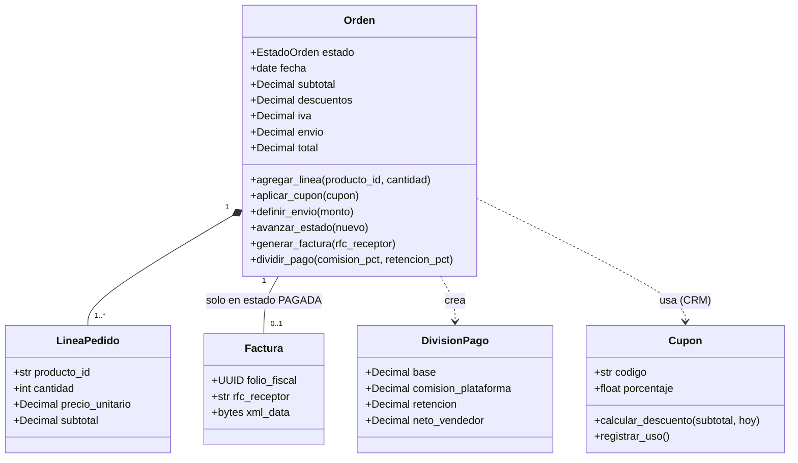
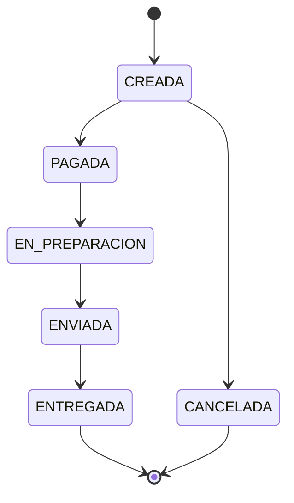

# Diseño UML de la capa de dominio — Módulo ERP (FACFOOD)

## Clases

## Máquina de estados de la orden

Regla: la secuencia es estricta e irreversible; está prohibido saltar estados.

## Fórmula del total

`Total = (Subtotal - Descuentos) + IVA(16%) + Envío`

El IVA se calcula sobre el monto ya con descuento.
